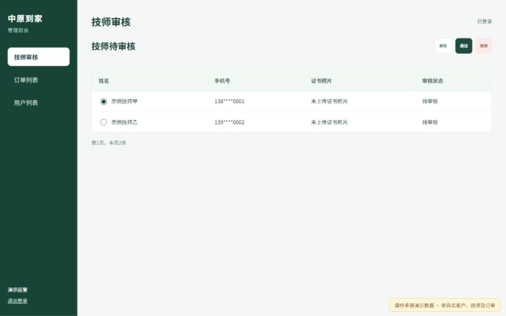
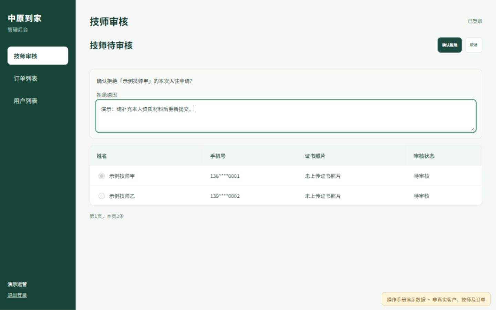
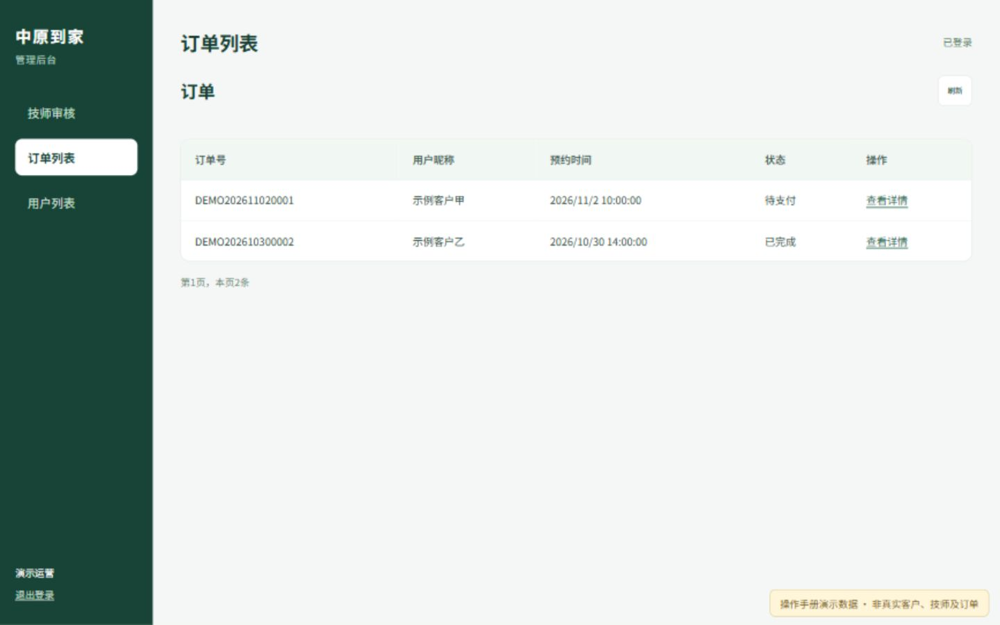
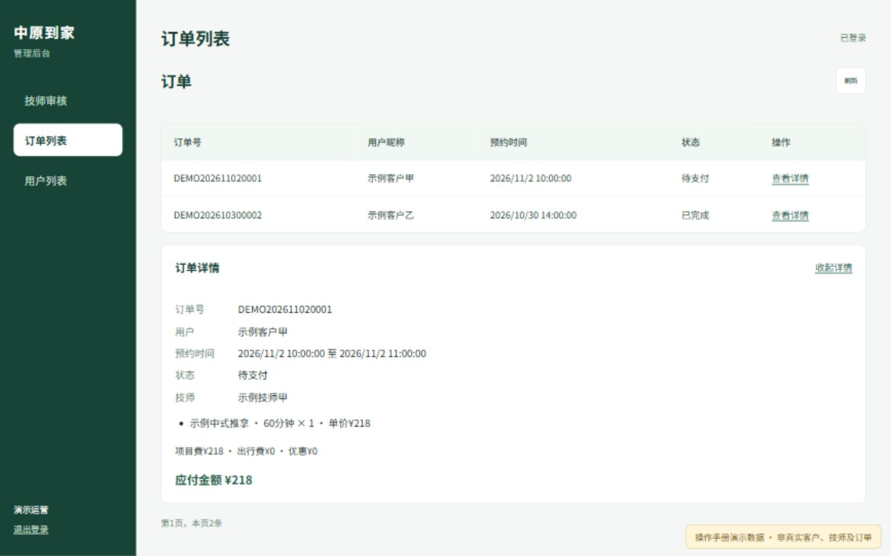
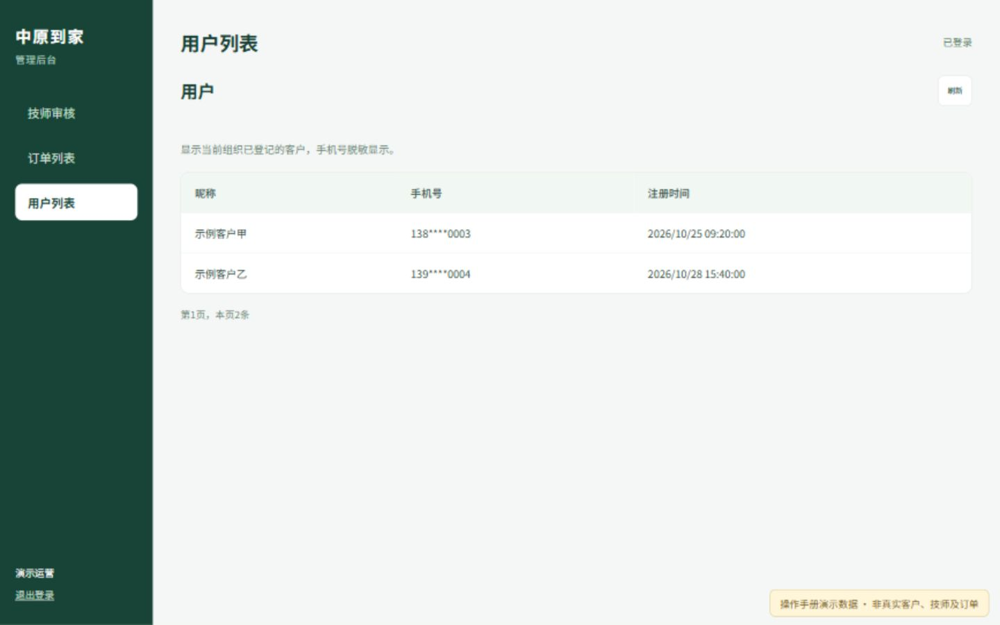

# 中原到家后台操作手册

本次将管理后台精简为三个业务页面：**技师审核、订单列表、用户列表**。原来的其他菜单入口已隐藏，原有业务资料继续保留。

本手册中的截图来自新版页面，使用专门的演示资料，不是真实客户、技师或订单；拍摄截图时没有审核任何真实申请。

## 一、打开后台

在电脑浏览器打开：[中原到家管理后台](https://admin.mtsc.top/login)。使用现有管理账号登录；本次没有更改账号、密码或权限。登录后默认进入“技师审核”。

左侧三个文字入口用于切换页面；左下角“退出登录”用于退出当前账号。没有登录时不会显示业务资料。

## 二、技师审核

页面只列出当前组织的待审核申请，表格共四列：**姓名、手机号、证书照片、审核状态**。手机号中间四位隐藏显示。点击姓名旁边的小圆圈选中一名技师，再进行审核。

| 按钮 | 作用 | 怎么使用 |
| --- | --- | --- |
| 刷新 | 重新读取待审核名单 | 查看技师新提交的申请时点击 |
| 通过 | 准备通过选中的申请 | 选中技师，点击后核对姓名，再点“确认通过” |
| 拒绝 | 准备退回选中的申请 | 选中技师，填写拒绝原因，再点“确认拒绝” |

未选中技师或正在读取、提交时，相关按钮会暂时变灰。确认界面只显示两个按钮：**确认通过／确认拒绝、取消**。“取消”返回名单，不改变审核状态。

### 拒绝申请的示例

拒绝原因需要填写 **2 至 500 个字**，例如“请补充本人资质材料后重新提交”。确认成功后，原因会同步到技师端。

服务器确认审核结果后，页面会提示成功并刷新名单。已通过或已拒绝的申请会离开待审核名单。审核通过与对客户公开展示、排班接单是不同步骤，仍按原有规则处理。

**关于证书照片：**目前已有资料没有独立的证书照片记录，所以显示“未上传证书照片”。姓名、手机号和审核状态读取真实申请；证书栏不会拿形象照或身份证冒充证书。此次按要求隐藏了资料编辑入口，没有新增证书上传表单。

### 如果出现“确认本人操作”弹窗

审核继续使用原有身份确认规则。填写手机验证器显示的 6 位动态码，点击“验证”；成功后点“返回原页面”，再次确认要进行的审核。验证成功本身不会自动通过或拒绝申请。

首次使用且尚未绑定验证器时，弹窗会显示“开始绑定验证器”。按页面说明由本人完成绑定，绑定密钥不要发给他人。已经开始绑定后退出的，可用同一登录会话中的验证器动态码继续完成；若没有保存绑定资料，按提示等待后重新绑定。

## 三、订单列表

表格共五列：**订单号、用户昵称、预约时间、状态、操作**。时间按北京时间显示。

| 控件 | 作用 |
| --- | --- |
| 刷新按钮 | 重新读取当前组织的订单记录 |
| 每行“查看详情”文字 | 在当前页面下方展开该订单的信息 |
| “收起详情”文字 | 关闭下方详情，保留订单列表 |

详情可以查看项目、时长、数量、技师、预约时间及金额。这里只查看订单，不提供改价、退款或删除订单入口。

## 四、用户列表

表格共三列：**昵称、手机号、注册时间**。本页只有一个“刷新”按钮，用于重新读取客户名单。

手机号中间四位隐藏；没有已验证手机号时显示“未填写”。名单只显示当前组织有权查看的客户，不会把其他组织、技师照片占位账号混进来。新客户完成手机号验证并登记到当前组织后可以出现；过去没有组织归属、也没有订单等关联的旧账号，不会被擅自归入本店。

## 五、翻页与常见提示

- 每页最多显示 20 条。有更多记录时，底部出现“下一页”文字；进入后续页面后可以点“上一页”。
- “没有待审核申请”表示当前待审核名单为空，不代表原有技师资料被删除。
- “资料已变化”表示其他人或技师更新了资料。请先点“取消”，再“刷新”，重新核对后审核。
- “申请资料尚未满足审核条件”表示仍需技师补齐资料，不会强行通过。
- 请求超时或网络失败时，请刷新核对最终状态，不要把等待画面当成已经成功。
- 提示没有权限时，需使用已有授权的管理账号；本次精简页面没有增加账号权限。

## 六、本版页面数量核对

| 业务页面 | 表格列数 | 同时显示的业务按钮 |
| --- | --- | --- |
| 技师审核 | 4 列 | 通常 3 个；确认时 2 个 |
| 订单列表 | 5 列 | 1 个 |
| 用户列表 | 3 列 | 1 个 |

页面切换、查看详情和翻页采用文字链接。登录页和必要的本人验证弹窗继续保留；本人验证弹窗最多两个按钮，弹窗打开时不显示背景业务按钮。
